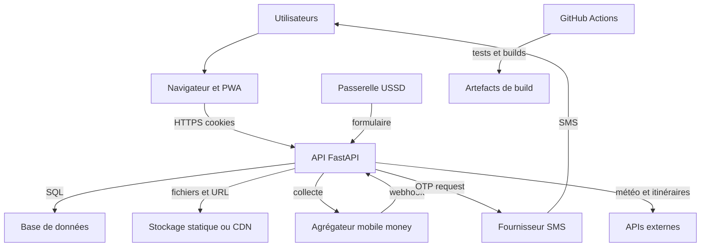

# Modèle de menaces — AgriConnect Burundi

**Date :** 14 novembre 2026  
**Périmètre :** application entière; constats initiaux établis avant durcissement  
**Méthode :** analyse statique du dépôt; aucun test, scan ou appel à la préproduction n’a été exécuté.

## Executive summary

L’analyse initiale a trouvé des défauts d’autorisation sur l’inscription, les commandes, les fichiers KYC et l’endpoint USSD. Les correctifs correspondants sont maintenant présents dans le working tree; le tableau ci-dessous décrit leur état et les risques qui restent. La préproduction est publique et les collectes sont réelles; les retraits sont manuels.

## État après durcissement du working tree

Les constats détaillés plus bas décrivent l’état observé avant les modifications de sécurité. Cette table reflète le code actuellement modifié, pas une version déjà déployée ni validée en exécution.

| Menace | État du correctif | Risque ou action restante |
|---|---|---|
| TM-001 — inscription et KYC | Corrigé dans le code : création liée à un défi OTP à usage unique; profils publics sans champs KYC privilégiés. | Appliquer la migration Alembic avant déploiement. |
| TM-002 — commandes et livraison | Corrigé dans le code : authentification par rôle, codes limités aux acteurs concernés, OTP à 6 chiffres avec verrouillage après échecs, affectation de livreur atomique; liste et transitions logistiques exigent une écriture `FUNDS_SENT_TO_ESCROW`. | Les anciennes commandes sans preuve de paiement sont bloquées jusqu'à rapprochement admin. Vérifier les parcours avec la passerelle avant mise en service. |
| TM-003 — documents KYC publics | Nouveaux documents stockés en privé; accès via route authentifiée; route statique KYC bloquée. | Les anciennes URL ImageKit déjà publiques peuvent rester accessibles jusqu’à révocation ou nouveau téléversement. Configurer les clés ImageKit. |
| TM-004 — usurpation USSD | L’API exige `X-USSD-Secret` et refuse l’accès sans secret. | Configurer le même secret aléatoire dans l’API et la passerelle; la signature du corps, l’anti-rejeu et la restriction réseau restent à confirmer. |
| TM-005 — uploads et mouvements de stock | Upload produit limité, validé et réservé au propriétaire; mouvements limités au fermier courant ou à l’admin. | Aucune limite par IP ou quota global d’upload n’est ajoutée. |
| TM-006 — cache PWA des réponses API | Les réponses de l’origine API utilisent `NetworkOnly`. | Les clients déjà ouverts doivent charger le nouveau service worker avant d’utiliser la nouvelle règle. |
| TM-007 — OTP | Six chiffres aléatoires cryptographiques; tentatives bornées de façon atomique; la ligne de délai reste conservée après vérification, expiration ou verrouillage. | Le délai reste limité au numéro; aucune limite par IP ou détection de campagnes SMS n’est configurée. |
| TM-008 — retraits manuels | Débit atomique; chaque retrait reste en attente jusqu’à une validation admin avec référence de paiement. | Rapprocher les retraits historiques déjà marqués terminés avec les preuves de paiement. |
| TM-009 — routes E2E | Le montage exige `ENVIRONMENT=test`, SQLite et le nom exact de base dédié. | Garder la base de test isolée et ne jamais définir ces paramètres en préproduction. |
| TM-010 — webhook mobile money | Commande et stock sont persistés avant l’appel agrégateur; erreur réseau laisse le statut en attente; le webhook demande un secret et la transition est idempotente par journal. Les références fournisseur sont uniques en base et une confirmation sans référence reste en attente. Un admin peut rapprocher un paiement reçu ou libérer le stock après vérification, avec référence/motif journalisés. | Le webhook ne vérifie pas encore une signature horodatée du corps ni l’état auprès du fournisseur; les réservations sans callback dépendent du rapprochement admin. |
| TM-011 — chaîne de dépendances | Pas de changement dans ce correctif. | Verrouiller les dépendances Python et épingler les actions CI par SHA dans une revue dédiée. |
| Litiges et remboursements | Création limitée aux commandes avec paiement comptabilisé; demande plafonnée au montant de commande; résolution unique; après livraison, le compte fermier est débité avant le crédit acheteur et doit couvrir le montant. Une commande encore en cours reste bloquée si un remboursement est accordé. | Les remboursements sur fonds en séquestre restent des écritures de solde internes et doivent être rapprochés du règlement réel. |
| Paiement coopératif | Une commande doit garder le même membre fermier comme bénéficiaire de paiement, même si plusieurs produits affichent la même coopérative. | Les paniers coopératifs de plusieurs membres sont refusés jusqu’à l’ajout d’une répartition explicite des paiements. |

Le démarrage en environnement public exige maintenant un secret de session d’au moins 32 caractères, une base PostgreSQL, des origines frontend HTTPS, un fournisseur SMS réel, une URL mobile money HTTPS avec clé et secret webhook, ainsi qu’une session `Secure`/`SameSite=None`. ImageKit doit être configuré pour accepter les téléversements KYC et produit; son endpoint doit être HTTPS. Le déploiement doit appliquer la nouvelle migration. Les valeurs de secrets du tableau de bord d’hébergement n’ont pas été consultées.

## Scope and assumptions

- **Inclus :** `app/`, `components/`, `lib/`, `backend/`, `next.config.mjs`, `render.yaml`, `.github/workflows/ci.yml`, `package.json`, `backend/requirements.txt` et les chemins de test conditionnels qui peuvent être montés par configuration.
- **Exclus :** valeurs des fichiers `.env` (non consultées), configuration réelle des tableaux de bord d’hébergement, contrôles internes des fournisseurs, dépendances générées hors vérification ciblée du cache PWA, et validation dynamique des hypothèses.
- L’instance visée est une **préproduction publique**. Les valeurs du modèle Render (`SMS_PROVIDER=console`, `MOBILE_MONEY_PROVIDER=mock`) ne correspondent donc pas nécessairement aux variables réellement déployées; l’utilisateur confirme que les collectes sont réelles et que les retraits sont manuels.
- La passerelle USSD n’a pas de protection confirmée. Le modèle traite le corps HTTP comme contrôlable par un visiteur Internet tant qu’une signature ou une restriction réseau indépendante n’est pas démontrée.
- Les numéros, soldes, historique des commandes et pièces d’identité KYC sont traités comme des données sensibles. Les données de préproduction sont supposées isolées de la production; si elles sont copiées depuis la production, l’impact augmente.
- Les statuts de retrait enregistrés par l’API ne sont pas une preuve de transfert : le service expose `initiate_payout`, mais aucun appel à cette méthode n’a été trouvé dans les routeurs runtime. Les retraits étant manuels, la procédure externe et sa preuve ne sont pas visibles dans ce dépôt.
- Aucun accès à un compte déjà créé, aux secrets d’hébergement, à la base ou aux comptes fournisseurs n’est supposé.

### Questions ouvertes qui changeraient le classement

- La préproduction contient-elle des données réelles ou une copie de données de production ?
- Les URL de documents KYC sont-elles censées être accessibles uniquement aux administrateurs ? L’implémentation actuelle les traite comme des URL publiques.
- La passerelle USSD applique-t-elle, hors de l’application, une signature vérifiable ou une liste d’IP ? Si oui, il faut ajouter cette preuve au modèle d’exploitation.

## System model

### Primary components

- **Frontend :** Next.js App Router / React, PWA. Les pages vérifient la session côté client; les appels API passent par `lib/api-config.ts` avec `credentials: include`.
- **API :** FastAPI expose les routeurs d’authentification, commandes, produits, utilisateurs, portefeuille, administration, OBR, USSD, paiements et autres domaines. Les contrôles d’accès sont écrits dans les handlers; ils ne sont pas appliqués uniformément par une dépendance globale.
- **Persistance :** SQLAlchemy, SQLite par défaut en développement et PostgreSQL configurable en production. Les sessions et OTP sont stockés en base.
- **Fichiers :** uploads produits et KYC dans un stockage local ou ImageKit. L’API monte aussi `backend/static` sur `/static` sans contrôle d’accès.
- **Fournisseurs :** SMS (console, Twilio ou Africa’s Talking), collecte mobile money (simulateur ou agrégateur REST), stockage ImageKit, OpenRouteService et Open-Meteo.
- **CI et tests :** GitHub Actions exécute les tests backend, le typecheck et le build. Les endpoints `/testing/*` sont montés uniquement si `E2E_TEST_MODE=true` et `ENVIRONMENT` n’est pas `production`.

### Data flows and trust boundaries

- **Visiteur → navigateur/PWA :** pages publiques et espaces par rôle. La protection de page est côté client; elle n’établit aucune autorisation pour une requête API directe.
- **Navigateur → FastAPI :** HTTP(S) inter-origines avec cookie de session. `apiFetch` envoie les cookies; CORS autorise les origines configurées et les origines localhost. En production le modèle Render configure `SameSite=None` et `Secure`; aucun jeton CSRF ni validation d’origine par handler n’a été trouvé. Les champs JSON sont généralement validés par Pydantic, mais certains endpoints acceptent des dictionnaires/formulaires libres.
- **FastAPI → base :** SQLAlchemy utilise les modèles et les filtres ORM. L’état d’identité, KYC, commandes, soldes, retraits, sessions et journaux d’audit traverse cette frontière. Le chiffrement au repos dépend de l’hébergeur et n’est pas défini dans le dépôt.
- **Navigateur/API → fichiers :** un utilisateur authentifié peut envoyer un document KYC (extension autorisée et limite de 5 Mo); les fichiers locaux sont ensuite disponibles sous `/static`. L’upload d’image produit n’a pas de contrôle de session, de propriétaire, de type MIME ni de taille dans son handler. ImageKit renvoie une URL directe sans configuration de fichier privé visible.
- **Agrégateur mobile money → webhook API :** JSON validé par Pydantic et en-tête partagé comparé avec `hmac.compare_digest`; le traitement de commande est idempotent par statut. Le secret est statique; aucune signature de corps, date ou référence fournisseur n’est vérifiée ici.
- **Passerelle USSD → API :** formulaire contenant `sessionId`, `serviceCode`, `phoneNumber` et `text`. Le code fait confiance à `phoneNumber` pour lire le solde et le nombre de commandes; aucune signature ou vérification de réseau n’apparaît dans le handler.
- **API → fournisseurs :** appels HTTP sortants avec clés d’environnement vers SMS, agrégateur, ImageKit, ORS et Open-Meteo. Les URL ORS/météo sont fixes; l’URL mobile money est une configuration opérateur. Les secrets eux-mêmes n’ont pas été lus.
- **Dépôt/CI → artefacts :** GitHub Actions installe les dépendances et exécute le code du dépôt. `package-lock.json` fixe les dépendances npm; `backend/requirements.txt` ne fixe pas les versions Python. Le modèle de menace n’inclut pas une compromission d’un fournisseur de dépendances, mais la chaîne mérite une revue dédiée.

#### Diagramme

## Assets and security objectives

| Asset | Why it matters | Security objective (C/I/A) |
|---|---|---|
| Numéros, noms, adresses, coordonnées | Identité et localisation des acheteurs, fermiers et livreurs | C, I |
| CNI/passeports, NIF et statut KYC | Risque d’usurpation, de fraude et de préjudice réglementaire | C, I |
| Cookies de session, OTP et rôles | Accès aux espaces et opérations privées | C, I |
| QR de collecte et OTP de livraison | Autorisent les transitions d’état d’une commande | C, I |
| Commandes, stock et historique de mouvements | Disponibilité des produits, livraison et contestation des ventes | C, I, A |
| Soldes, transactions, commission et retraits | Comptabilité interne et règlement des fermiers/livreurs | I, A, C |
| Clés SMS, mobile money, ImageKit, ORS, secret webhook et DB | Accès aux fournisseurs et aux données | C, I, A |
| Documents et images uploadés, cache PWA | Documents sensibles, intégrité des annonces et données hors ligne | C, I, A |
| Source, dépendances et workflow CI | Intégrité des versions livrées | I, A |

## Attacker model

### Capabilities

- Un attaquant distant peut appeler directement l’API publique de préproduction, forger JSON, paramètres de requête et formulaires, et ignorer les gardes d’interface Next.js.
- Un utilisateur authentifié avec un rôle ordinaire peut tenter de modifier son profil, publier des produits ou agir sur les commandes auxquelles il accède.
- Les identifiants numériques de ressources et les numéros de téléphone peuvent être devinés ou énumérés; les endpoints ne doivent pas s’appuyer sur leur caractère secret.
- Un utilisateur d’un appareil partagé peut consulter les données qui y restent dans le stockage navigateur ou le cache service worker, surtout hors ligne.

### Non-capabilities

- Le modèle ne suppose pas l’accès aux secrets, à la base, au compte admin, au panneau Render/Netlify, au compte mobile money ou aux systèmes internes de la passerelle.
- La création publique refuse les rôles `admin`, `obr` et `ministere_agriculture`; le risque d’inscription décrit ci-dessous concerne les rôles acheteur, fermier ou logistique.
- Le chemin d’inscription directe ne permet pas de remplacer un compte existant portant le même numéro grâce à l’unicité en base. Il permet cependant de réclamer un numéro qui n’est pas encore enregistré et d’obtenir immédiatement une session.
- Les transferts de retrait sont manuels selon le contexte fourni; aucun vol de retrait automatisé via ce dépôt n’est affirmé.

## Entry points and attack surfaces

| Surface | How reached | Trust boundary | Notes | Evidence (repo path / symbol) |
|---|---|---|---|---|
| Pages publiques et API catalogue | Navigateur ou requête HTTP | Internet → frontend/API | Catalogue, prix, catégories, météo, statistiques publiques et traçabilité sont publics par conception. FastAPI garde aussi ses endpoints de documentation par défaut. | `app/page.tsx`; `backend/routers/products.py:get_products`; `backend/routers/market.py`; `backend/main.py:FastAPI` |
| OTP, inscription, session | POST `/auth/*` | Internet → API d’identité | OTP persistant avec expiration, limite d’essais et délai par numéro; inscription directe séparée du flux OTP de l’interface. | `backend/routers/auth.py:request_otp`, `verify_otp`, `register_user`; `backend/services/user_service.py:persist_user` |
| Commandes et logistique | POST/GET `/orders/*` | Internet/utilisateur → état financier et logistique | Des handlers n’exigent pas la session; les listes renvoient des codes de commande. | `backend/routers/orders.py:get_logistics_orders`, `get_buyer_orders`, `pickup_order`, `deliver_order` |
| Profil, portefeuille, admin, OBR | `/users/*`, `/wallet/*`, `/admin/*`, `/obr/*` | Cookie de session → données par rôle | Plusieurs handlers vérifient bien la session et le rôle; le contrôle KYC est contournable via les champs d’inscription/mise à jour. | `backend/routers/users.py`; `wallet.py`; `admin.py:check_admin_auth`; `obr.py` |
| Uploads et fichiers statiques | Multipart puis GET `/static/*` | Utilisateur → stockage public | KYC upload authentifié mais lecture statique non protégée; upload image produit non authentifié. | `backend/routers/users.py:upload_kyc_document`; `backend/routers/products.py:upload_product_image`; `backend/main.py:app.mount` |
| USSD | POST formulaire `/ussd` | Passerelle ou Internet → données de compte | Le handler utilise le numéro envoyé dans le formulaire comme identité. | `backend/routers/ussd.py:handle_ussd` |
| Webhook mobile money | POST `/payments/webhook` | Agrégateur → API | Secret partagé dans l’en-tête, contrôle d’égalité en temps constant et idempotence de commande. | `backend/routers/payments.py:payment_webhook` |
| Bootstrap admin | POST `/bootstrap/admin` | Opérateur → création du premier admin | Secret requis et route désactivée dès qu’un admin existe. | `backend/routers/bootstrap.py:bootstrap_admin` |
| APIs externes | Appels sortants HTTP | API → fournisseur | SMS, mobile money, ImageKit, météo et routage. | `backend/services/sms_service.py`; `mobile_money_service.py`; `file_storage_service.py`; `weather_service.py`; `utils.py` |
| Routes E2E | `/testing/*` | Test runner → API | Création arbitraire d’utilisateurs/commandes et lecture de données sans auth; montage conditionnel par environnement. | `backend/config.py:E2E_TEST_MODE`; `backend/main.py`; `backend/routers/testing.py` |
| Cache PWA/API | GET cross-origin du navigateur | API → cache local navigateur | `/auth/me` est NetworkOnly, mais le cache Workbox par défaut couvre les autres GET cross-origin. | `next.config.mjs`; `lib/api-config.ts:apiFetch`; cache `cross-origin` de `@ducanh2912/next-pwa` |
| CI et dépendances | Push/PR GitHub | Développeur/dépendances → build | CI installe Python non verrouillé et exécute les tests/build sur le code de branche. | `.github/workflows/ci.yml`; `backend/requirements.txt`; `package-lock.json` |

## Top abuse paths

1. **Objectif : créer un fermier sans vérifier le téléphone ni le KYC.** Chemin : POST `/auth/register` avec un numéro non enregistré, `role=fermier` et `kyc_status=verified` → la route persiste l’utilisateur et crée sa session → les contrôles KYC acceptent ensuite ce statut. Impact : comptes fictifs et KYC non fiable. Cela ne prend pas le contrôle d’un compte existant.
2. **Objectif : valider une livraison inexistante.** Chemin : GET `/orders/logistics` sans cookie pour récupérer QR/OTP → POST `/orders/{id}/deliver?otp_code=...` sans session → commande `COMPLETED` et solde du fermier crédité. Impact : fausse preuve de livraison et possible paiement manuel induit en erreur.
3. **Objectif : extraire les commandes d’un acheteur.** Chemin : énumérer les `buyer_id` → appeler `/orders/buyer/{buyer_id}` sans session → récupérer articles, montants, livreur et codes. Impact : fuite de données; les identifiants incrémentaux ne sont pas une autorisation.
4. **Objectif : lire une pièce d’identité.** Chemin : obtenir une URL de document depuis un profil/écran admin → télécharger `/static/uploads/kyc/...` directement → le montage statique sert le fichier sans cookie. Impact : exposition de CNI/passeport. ImageKit reçoit aussi le fichier sans indicateur privé visible.
5. **Objectif : usurper un abonné USSD.** Chemin : envoyer un formulaire avec le `phoneNumber` d’un fermier et choix `2` ou `3` → si aucun contrôle passerelle n’existe, l’API renvoie son solde ou son nombre de commandes. Impact : divulgation financière/commerciale.
6. **Objectif : altérer le catalogue ou épuiser le stockage.** Chemin : sans session, envoyer un gros fichier à l’upload d’un produit connu → l’API lit tout en mémoire, remplace l’URL et peut consommer disque/CDN. Impact : défiguration ou déni de service. Une autre lecture anonyme, `/stock-movements`, expose les historiques d’inventaire.
7. **Objectif : réutiliser les données d’un autre utilisateur sur un appareil partagé.** Chemin : obtenir une réponse GET authentifiée mise en cache → changer de compte ou passer hors ligne → Workbox peut restituer la réponse de la même URL sans distinguer le cookie. Impact : fuite locale de messages, soldes ou profil.
8. **Objectif : deviner l’OTP d’un compte ciblé.** Chemin : renouveler l’OTP toutes les 60 secondes → tenter les cinq valeurs autorisées par code → répéter sans limite globale IP/journalière visible. Impact : prise de session si le code est trouvé; génération sur quatre chiffres via `random.randint`.
9. **Objectif : faire apparaître un retrait comme payé sans transfert vérifiable.** Chemin : demander un retrait admissible → l’API débite le solde et marque `completed` sans appeler le service payout → l’opérateur peut se fier au statut. Impact : paiement manuel omis ou contesté et rapprochement financier erroné.
10. **Objectif : confirmer une commande sans collecte réelle après compromission du secret webhook.** Chemin : obtenir le secret partagé → envoyer un `SUCCESS` avec la référence d’une commande en attente → l’API marque la commande payée sans vérifier auprès du fournisseur. Impact : commande non payée traitée comme escrow.

## Threat model table

| Threat ID | Threat source | Prerequisites | Threat action | Impact | Impacted assets | Existing controls (evidence) | Gaps | Recommended mitigations | Detection ideas | Likelihood | Impact severity | Priority |
|---|---|---|---|---|---|---|---|---|---|---|---|---|
| TM-001 | Visiteur Internet | Un numéro non déjà inscrit; API accessible publiquement. | Inscription sans OTP avec rôle fermier et `kyc_status=verified`; reçoit une session. | Comptes fermiers fictifs et KYC contourné; données d’identité et demandes de crédit/retrait non fiables. Le rôle admin reste bloqué. | Rôles, KYC, soldes, confiance du marché | Le frontend demande un OTP; `persist_user` interdit admin/OBR/ministère. | `/auth/register` n’exige aucun défi OTP; `UserCreate` accepte `kyc_status`; `UserUpdate` laisse aussi l’utilisateur le modifier. | Exiger un jeton de défi OTP à usage unique lié au numéro et consommé par le serveur; forcer KYC à `pending` dans création/mise à jour publiques; appliquer une liste blanche de champs; ne modifier KYC qu’avec rôle admin. | Journaliser OTP vérifié, création de compte et changement d’état KYC avec acteur/motif; alerter sur `verified` sans validation admin. | High — endpoint public direct, sans étape de possession téléphone. | High — fraude d’identité et contournement de contrôles KYC. | high |
| TM-002 | Visiteur Internet | Commande payée visible via endpoint logistique; API accessible. | Lire les codes sur `/orders/logistics` ou `/orders/buyer/{id}`, puis appeler `/orders/{id}/deliver` sans session. | Livraison fictive; libération du solde fermier et possible règlement manuel induit en erreur. | Commandes payées, preuve de livraison, soldes et paiements réels | Vérification du code et de l’état; `/orders/{id}` détail est authentifié et vérifie le rôle. | Les routes liste exposent les codes; delivery/pickup ne vérifient ni session, ni rôle, ni livreur assigné pour l’action de livraison. | Exiger session et rôle livreur; lier le livreur à la commande; séparer les données de dispatch des secrets; révéler OTP uniquement au destinataire autorisé; faire une transition atomique/idempotente et exiger preuve de livraison. | Alerter sur transitions sans session/livreur; journaliser l’acteur et l’origine; rapprocher livraison, OTP et règlement manuel. | High — les endpoints sont directement appelables et les codes retournés par l’API. | High — les collectes sont réelles; le registre de règlement peut être manipulé. | high |
| TM-003 | Visiteur connaissant ou découvrant une URL de document | Document KYC téléversé; stockage local ou URL ImageKit accessible. | Télécharger le document par son URL directe sans session. | Exposition de CNI/passeport, NIF et identité; risque d’usurpation et de préjudice durable. | Données KYC et identité | Upload KYC exige une session, extension autorisée et limite 5 Mo. | `/static` est public; URL locale sous `/static/uploads/kyc`; aucune URL signée ou option privée visible pour ImageKit. Protection de l’upload ne protège pas la lecture. | Stocker les documents dans un bucket privé; servir via endpoint autorisé ou lien signé court; séparer les fichiers KYC des médias publics; invalider les URL déjà exposées et limiter leur conservation. | Journaliser chaque consultation de document; alerter sur téléchargements répétés/énumération; auditer l’accès administrateur. | Medium — accès direct nécessite une URL ou découverte, mais le fichier n’a pas d’ACL. | High — document d’identité très sensible. | high |
| TM-004 | Appelant de l’endpoint USSD | Endpoint préproduction joignable; absence de signature/allowlist externe (non confirmée). | Forger `phoneNumber` dans le formulaire pour demander solde ou commandes en attente. | Divulgation de soldes et activité commerciale; énumération de numéros/comptes. | Données financières et activité des fermiers | Formulaire attendu d’un opérateur télécom selon commentaire du code. | Aucun contrôle d’authenticité du `sessionId`, de signature ou d’IP dans le handler; numéro du corps utilisé directement. | Valider une signature HMAC du corps avec timestamp et anti-rejeu; ou restreindre réseau à la passerelle et valider son certificat; ne pas renvoyer de solde sans facteur/PIN adapté. | Refuser et journaliser les échecs de signature; alerter sur un même IP/numéro testant de nombreux comptes. | Medium — dépend de contrôles de passerelle hors dépôt. | High — exposition de données de comptes. | high |
| TM-005 | Visiteur Internet / concurrent | API publique accessible; ID produit ou fermier connu/devinable. | Téléverser un gros fichier vers l’image d’un produit sans session ou lire `/stock-movements` sans authentification. | Défiguration, consommation mémoire/stockage/CDN, ou divulgation de volumes et rythme de stock. | Catalogue, API, stockage et données commerciales | Le KYC limite taille/extension; les opérations produit normales vérifient rôle/propriété. | Upload produit n’exige ni session, ni propriétaire, ni taille/type; lecture mouvements n’exige pas de session et peut retourner tous fermiers. | Authentifier et vérifier propriété; borner/streamer/decoder les uploads; filtrer les mouvements sur l’utilisateur courant et réserver l’accès global à l’admin. | Mesurer tailles/uploads, logs d’échecs et lectures mouvements par IP/fermier; alerter sur balayage ou volume inhabituel. | High — endpoints accessibles anonymement. | Medium — intégrité/disponibilité et données commerciales. | medium |
| TM-006 | Utilisateur d’un appareil partagé | Frontend et API sur origines distinctes; réponse GET privée déjà passée en cache; appareil ensuite partagé/hors ligne. | Lire une réponse `NetworkFirst` mise en cache pour URL identique après changement de compte ou coupure réseau. | Consultation de messages, soldes ou profils périmés d’un autre utilisateur. | PII, soldes, messages et cache local | `/auth/me` est explicitement NetworkOnly; les réponses ont une expiration Workbox. | Les autres GET cross-origin peuvent être mis en cache jusqu’à une heure; cache par URL, pas par cookie/utilisateur; `apiFetch` envoie les credentials. | Ne pas cacher les routes authentifiées; configurer `Cache-Control: private, no-store`; ajouter des règles NetworkOnly par origine API; purger caches au logout/changement de session et tester hors ligne sur appareil partagé. | Ajouter des tests de non-cache pour réponses privées; inspecter cache worker et déclencher une alerte/telemetry sur fallback offline des endpoints sensibles. | Medium — nécessite partage d’appareil ou session hors ligne. | Medium — fuite locale de données de compte, sans accès distant direct. | medium |
| TM-007 | Attaquant ciblant un numéro inscrit | Numéro connu; temps et capacité à répéter des requêtes. | Renouveler l’OTP au délai minimal puis utiliser les cinq essais par code pour deviner un code valide. | Prise de contrôle de session si le code est deviné; impact sur données, commandes et solde du compte ciblé. | Session et compte | Expiration OTP, cinq essais et délai d’envoi par numéro; cookie HttpOnly, Secure en production. | OTP à 4 chiffres produit avec PRNG non cryptographique; délai par numéro seulement, sans limite IP, seuil journalier ou verrouillage progressif. | Générer avec `secrets`; limiter demande et vérification par IP + numéro + fenêtre globale; imposer délai exponentiel/lockout et détection d’anomalies; invalider les codes précédents. | Métriques d’essais par compte/IP, alertes sur rotation d’OTP et taux d’échec anormal. | Medium — il faut un ciblage et des tentatives répétées, mais le service ne bloque pas durablement. | High — session de compte compromise. | medium |
| TM-008 | Utilisateur fermier ou erreur de processus | Fermier éligible au chemin automatique de retrait, ou admin qui approuve une demande. | Déclencher un retrait; l’API débite le solde et marque `completed` sans appeler `initiate_payout`; l’admin fait la même transition en approbation. | Registre indique « payé » sans preuve de transfert; règlement manuel omis ou contesté, rapprochement financier incorrect. | Soldes, retraits et journal d’audit | KYC, solde minimum, historique de livraison, comparaison du numéro et seuil de revue; approbation/rejet admin journalisés. | Méthode de payout existe mais n’est pas appelée dans le runtime; statut n’est pas corrélé à une confirmation de paiement externe. | Pour retrait manuel, garder `pending` jusqu’à saisie d’une référence/preuve et double validation; pour automatique, appeler le fournisseur avec référence idempotente et marquer `completed` seulement après confirmation authentifiée. | Rapport quotidien des retraits `completed` sans référence fournisseur/preuve; rapprochement avec relevé opérateur. | Medium — le statut est atteint par un flux normal du portefeuille. | High — impact sur paiement dû et comptabilité, sans preuve d’un transfert automatique. | medium |
| TM-009 | Visiteur Internet en préproduction mal configurée | `E2E_TEST_MODE=true` et `ENVIRONMENT` différent de `production`. | Utiliser `/testing/*` pour créer n’importe quel rôle, lister utilisateurs et lire données; le démarrage peut aussi vider la base. | Compromission des données de staging ou perte totale de la base de préproduction. | Comptes, données et disponibilité de la base | Le router est conditionnel; le flag est désactivé par défaut et forcé faux quand l’environnement vaut `production`. | La garde repose sur configuration exacte; endpoints eux-mêmes n’ont pas d’auth car conçus pour E2E; activation en environnement public non-prod les expose. | Interdire le flag hors runner E2E isolé; exiger un secret/session sur routes de test ou ne pas monter le router dans les builds déployables; garder la base E2E dédiée. | Vérifier au démarrage la combinaison environnement/flag; alerter si `/testing` est monté ou appelé en dehors de CI. | Low — nécessite une mauvaise configuration, non confirmée dans la préproduction. | High — lecture/écriture sans auth et `drop_all`. | medium |
| TM-010 | Agrégateur compromis ou détenteur du secret | Secret webhook compromis ou intégration fournisseur malveillante; commande `PENDING_PAYMENT`. | Envoyer un webhook `SUCCESS` avec la référence de commande; le handler fait confiance au statut et ne vérifie pas `provider_ref` auprès du fournisseur. | Commande non payée marquée comme payée, puis possibilité de livraison et crédit de solde. | État paiement/escrow, stock, soldes | En-tête secret comparé en temps constant; schéma Pydantic; rejeu inoffensif après changement de statut. | Secret partagé statique; pas de signature du corps, timestamp/anti-rejeu ni vérification fournisseur de la collecte. | Signer le corps canonique avec timestamp/nonce; valider la référence/status auprès du fournisseur; secrets par environnement et rotation; garder idempotence transactionnelle. | Rapprocher chaque `SUCCESS` avec l’identifiant fournisseur et montant; alerter sur référence répétée/inconnue ou statut incohérent. | Low — exige compromission/configuration du secret fournisseur. | High — fausse confirmation financière. | medium |
| TM-011 | Dépendance ou acteur de chaîne CI compromis | Version Python compromise/non reproductible, action GitHub compromise ou changement de dépôt malveillant. | Faire exécuter du code pendant `pip install`, test ou build et contaminer l’artefact de préproduction. | Compromission des artefacts et potentielle exfiltration de secrets disponibles au job. | Source, artefacts et secrets CI | `package-lock.json` fixe npm; CI exécute tests et build; action checkout/setup est versionnée par tag majeur. | `requirements.txt` ne fixe aucune version; actions non épinglées par SHA; aucune provenance/SBOM visible. Permissions effectives du workflow dépendent des réglages GitHub non fournis. | Verrouiller Python avec hashes; épingler Actions par SHA; réduire permissions de job; séparer secrets de build de PR non fiables; produire SBOM/provenance et revue des mises à jour. | Alerter sur changements de dépendances/actions; vérifier provenance/hash des artefacts et événements d’accès aux secrets. | Low — nécessite compromission amont ou changement malveillant. | High — le build peut devenir l’application livrée. | medium |

## Criticality calibration

- **Critical :** vol de session admin donnant accès à la gestion des comptes; accès arbitraire à PostgreSQL; transfert non autorisé de fonds à grande échelle. Aucun n’est confirmé directement par les handlers examinés.
- **High :** création de comptes fermiers auto-vérifiés; fausse livraison qui libère un solde réel; exposition de CNI/passeports. Ce sont les risques les plus graves trouvés dans le code.
- **Medium :** usurpation USSD révélant un solde; données API remises depuis le cache sur appareil partagé; retrait marqué terminé sans preuve externe.
- **Low :** lecture de prix agrégés, météo ou catalogue actif déjà publics; métadonnées techniques sans données privées.

La préproduction publique augmente la probabilité d’exploitation des routes sans auth. Les retraits manuels réduisent la certitude d’un impact de sortie de fonds, mais ne réduisent pas l’impact de faux états de livraison, de solde ou de paiement dû. L’authentification réelle de l’USSD et la nature des données de préproduction sont les principales incertitudes restantes.

## Focus paths for security review

| Path | Why it matters | Related Threat IDs |
|---|---|---|
| `backend/routers/auth.py` | Inscription sans défi OTP lié, création immédiate de session. | TM-001, TM-007 |
| `backend/services/user_service.py` | Champs UserCreate persistés; restriction de rôles privilégiés à préserver. | TM-001 |
| `backend/schemas.py` | `UserCreate`/`UserUpdate` incluent `kyc_status` et données d’identité. | TM-001 |
| `backend/routers/users.py` | Mise à jour de KYC, upload et URL de document. | TM-001, TM-003 |
| `backend/routers/orders.py` | Exposition des codes et transitions pickup/delivery sans session. | TM-002 |
| `backend/services/payment_service.py` | Libération des soldes et comptabilisation de l’escrow. | TM-002, TM-008 |
| `backend/routers/wallet.py` | Débit et état final des retraits. | TM-008 |
| `backend/routers/admin.py` | Approbation manuelle marquant un retrait terminé sans appel fournisseur. | TM-008 |
| `backend/routers/products.py` | Upload image sans auth/ownership ni taille maximale. | TM-005 |
| `backend/routers/stock_movements.py` | Lecture anonyme d’historique inventaire. | TM-005 |
| `backend/routers/ussd.py` | `phoneNumber` de formulaire utilisé comme identité. | TM-004 |
| `backend/main.py` | Montage public `/static`, inclusion conditionnelle du router E2E. | TM-003, TM-009 |
| `backend/services/file_storage_service.py` | Stockage local/CDN et génération d’URL de fichier. | TM-003, TM-005 |
| `backend/config.py` et `render.yaml` | Garde d’environnement, providers mock/console, secrets et cookies. | TM-004, TM-009 |
| `next.config.mjs` et `lib/api-config.ts` | Règles PWA et requêtes API avec cookies. | TM-006 |
| `backend/routers/payments.py` | Authentification et idempotence du webhook d’encaissement. | TM-010 |
| `.github/workflows/ci.yml` et `backend/requirements.txt` | Contrôle de la chaîne de build et dépendances Python non verrouillées. | CI / supply chain |

## Notes on use

- Le modèle couvre les surfaces découvertes par domaine; les routes publiques catalogue/météo/statistiques sont distinguées des routes privées dans le tableau d’entrée.
- Les menaces couvrent les frontières principales : navigateur/API/DB (TM-001/002), API/fichiers publics (TM-003/005), USSD (TM-004), cache navigateur/API (TM-006), OTP/SMS (TM-007), portefeuille et mobile money (TM-008/010), routes E2E conditionnelles (TM-009) et chaîne CI (TM-011). Les appels météo/routage ont des destinations fixes; aucun URL contrôlé par l’utilisateur n’a été trouvé dans ces flux.
- Runtime, E2E et CI sont séparés dans le modèle; les chemins E2E sont conditionnels et la CI est traitée comme une frontière de livraison, pas comme une route runtime.
- Les réponses utilisateur sont intégrées : préproduction publique, collectes réelles, retraits manuels et protection USSD non confirmée.
- Les hypothèses non résolues — données de préproduction et contrôles externes de la passerelle USSD — restent listées dans la portée et modulent les priorités.
- Les contrôles constatés comprennent cookies de session HttpOnly, Secure en production, expiration OTP/session, checks de rôles admin sur les handlers concernés, validation du webhook, et garde conditionnelle du router E2E.
- **Limites :** aucun test automatisé ou manuel n’a été exécuté et aucune requête n’a été envoyée à la préproduction. Les routes réelles, la configuration hébergeur, l’authentification de la passerelle USSD et la procédure de retrait doivent être confirmées avant de traiter ce document comme validation de production.
- Plusieurs tests unitaires appellent directement la façade métier de `backend/main.py`, alors que les handlers runtime résident dans `backend/routers/`; ajouter des tests HTTP pour les routes listées ci-dessus est nécessaire pour vérifier les contrôles réellement exposés.
